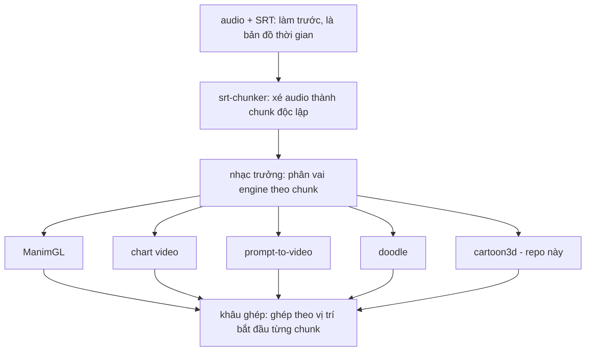
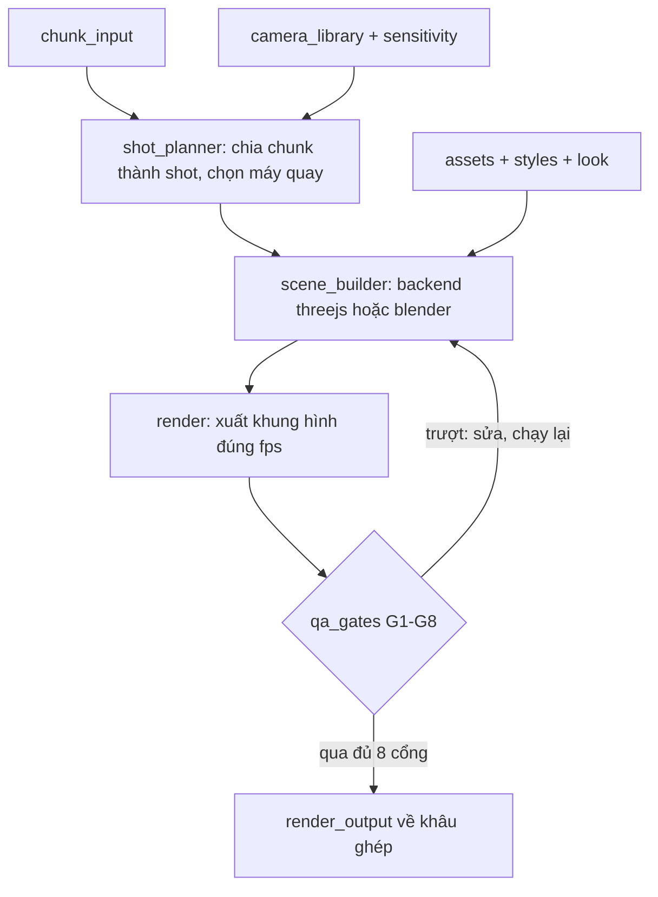

# Spec cartoon3d-engine — module hoạt hình 3D trong video engine

`cartoon3d-engine` là một engine sinh video trong roster của video engine: nhận một chunk đã có timeline SRT từ nhạc trưởng, trả về video hoạt hình 3D dựng bằng code, đúng thời lượng chunk. Bản gốc của mọi thứ là file chữ (JSON + script); video chỉ là sản phẩm sinh ra, không đưa lên Git.

Hợp đồng vào/ra, Look system, Ports và cổng kiểm chung: xem `engine-contracts/docs/spec.md`. Engine này không in phụ đề — phụ đề in một lần ở khâu ghép.

## Mục tiêu và phạm vi

**Trong phạm vi**

- Dựng cảnh từ thư viện tài sản dùng chung: nhân vật, bối cảnh, đồ vật.
- Camera animation theo thư viện chuyển động có tên (dolly, orbit, track_to, cut).
- Ba phong cách cắm rời: `toon`, `voxel`, `pixel3d`.
- Ngôn ngữ hình ảnh theo mức nhạy cảm của từng shot (ám chỉ thay vì phô bày) cho dòng vụ án.
- Render, tự kiểm bằng ảnh chụp và cổng kiểm.
- Hai backend cùng ăn một spec shot: `threejs` (giai đoạn đầu) và `blender` (nâng chất lượng).

**Ngoài phạm vi**

- Chia SRT thành chunk và phân vai engine: việc của `srt-chunker` và nhạc trưởng.
- Lồng tiếng, nhạc, phụ đề, ghép và co giãn giữa các chunk: khâu ghép của video engine.
- Quét lời thoại nhạy cảm: `sensitive-term-audit` ở thượng nguồn; engine này chỉ nhận mức nhạy cảm đã gắn sẵn.

## Vị trí trong video engine



Repo này chỉ thêm một ô trong roster: cùng hợp đồng chunk vào và video ra như các engine còn lại, nên nhạc trưởng và khâu ghép không phải sửa.

## Luồng pipeline và bảng module



| Module | Input | Output | Công cụ |
| --- | --- | --- | --- |
| `shot_planner` | `chunk_input.json` | danh sách `shot.json` | Claude + `camera_library` |
| `scene_builder` | `shot.json`, `assets/`, `styles/` | cảnh dựng sẵn | Three.js hoặc Blender (`bpy`) |
| `render` | cảnh + timeline | khung hình `.png` | Chrome headless / Blender `--background` |
| `look_adapter` | `look_profile` | màu, nét, chuyển động theo look | đọc `engine-contracts/looks` |
| `qa_gates` | khung hình + shot | `qa_report.json` | ffprobe, jsonschema, contact sheet |
| đóng gói | khung hình đã qua cổng | `.mp4` + `render_output.json` | ffmpeg |

## Cấu trúc thư mục repo

```
cartoon3d-engine/
├── AGENTS.md              # luật riêng của repo, kế thừa agent-rules
├── README.md
├── docs/spec.md
├── specs/
│   ├── shot.schema.json
│   └── asset.schema.json
├── core/
│   ├── shot_planner/      # chunk → danh sách shot
│   ├── camera_library/    # dolly, orbit, track_to, cut
│   ├── sensitivity/       # mức nhạy cảm → thủ pháp hình ảnh
│   ├── look_adapter/      # dịch look token sang vật liệu, nét viền
│   └── qa_gates/          # cổng kiểm tự động
├── backends/
│   ├── threejs/           # scene_builder.js, capture.py
│   └── blender/           # build_scene.py, render.py
├── styles/                # toon.json, voxel.json, pixel3d.json
├── assets/
│   ├── registry.json      # sổ tài sản + giấy phép
│   ├── characters/        # mỗi nhân vật một file .json
│   ├── sets/              # bank_hall, cheese_vault, police_station...
│   ├── props/
│   └── external/          # file nặng tải ngoài — Git LFS hoặc NAS
├── tests/fixtures/        # cảnh mẫu cheese_bank
└── out/                   # render — nằm trong .gitignore
```

- Input của từng tập do video engine giữ; repo chỉ nhận chunk.
- Nhân vật và bối cảnh là file chữ: nhân vật `toon` là bộ tham số khối, nhân vật `voxel` là lưới `(x, y, z, màu)`.
- `chunk_input.schema.json` và `render_output.schema.json` lấy từ `engine-contracts`, không copy vào đây.

## Schema shot

| Hợp đồng | Trường chính | Ai viết |
| --- | --- | --- |
| `shot` | `shot_id`, `duration_ms`, `set`, `cast[]`, `camera`, `look_id`, `sensitivity_device` | `shot_planner` |
| `asset` | `asset_id`, `kind`, `source`, `license`, `commercial_ok`, `redistribute_ok`, `path`, `version` | Người dựng tài sản |

Ví dụ một shot, lấy từ cảnh phô mai đã dựng thử:

```json
{
  "shot_id": "000004200_002_s1",
  "duration_ms": 4200,
  "style": "toon",
  "set": "cheese_vault",
  "cast": [
    {"id": "cheesemaker", "action": "walk_carry", "path": "vault_entry"}
  ],
  "camera": {
    "move": "dolly",
    "from": [0.25, 1.95, 2.2],
    "to": [0.25, 1.8, -11.5],
    "look_at": "target_empty",
    "interp": "ease_in_out"
  },
  "look_id": "test_warm",
  "sensitivity_device": "none"
}
```

- `interp` dùng tên của Blender (`linear`, `ease_in`, `ease_out`, `ease_in_out`, `constant`, `bounce`), không dùng tên của After Effects. Lưu ý: "Ease In" của Blender = chậm ở đầu đoạn, ngược nghĩa với "Easy Ease In" của After Effects.
- `sensitivity_device` nhận một trong: `none`, `cut_away`, `silhouette`, `symbol_object`, `top_down_diagram`, `offscreen_sound`.

## Thư viện tài sản và giấy phép

Mọi tài sản phải có dòng trong `assets/registry.json` thì mới được render; dòng đó ghi nguồn và hai cờ quyền dùng.

| Nguồn | `commercial_ok` | `redistribute_ok` | Ghi chú |
| --- | --- | --- | --- |
| Tự dựng bằng script | true | true | Ưu tiên số 1, nhất là nhân vật |
| CC0 (Poly Haven, Kenney, Quaternius) | true | true | Không cần ghi nguồn |
| Meshy / Tripo gói trả phí | true | false | Gói miễn phí bị chặn vào render |
| Mixamo | true | false | Không đóng gói file gốc vào sản phẩm bán |
| BlenderKit | theo từng tài sản | theo từng tài sản | Ghi giấy phép cụ thể khi tải |

- `asset_id` giữ cố định qua mọi tập: nhân vật `banker` của tập 1 và tập 50 là một file, đổi ngoại hình thì tăng `version`.
- Bộ công cụ nếu sau này đem bán chỉ được chứa tài sản có `redistribute_ok = true`.
- File nặng (`.glb`, `.blend`, `.vox`) nằm ngoài Git thường, dùng Git LFS hoặc ổ NAS chung cho hai máy.
- Mô hình 3D sinh bằng AI lấy qua port `model3d_provider` (xem `engine-contracts`).

## Cổng kiểm chất lượng

Một chunk chỉ được trả về nhạc trưởng khi qua đủ 8 cổng; cổng nào trượt thì agent tự sửa rồi chạy lại, không giao video lỗi.

| Cổng | Kiểm gì | Cách kiểm |
| --- | --- | --- |
| G1 Schema | Shot và chunk đúng schema | `jsonschema` |
| G2 Giấy phép | Mọi tài sản có trong registry, `commercial_ok = true` | Đối chiếu registry |
| G3 Thời lượng | Số khung = làm tròn(`duration_ms` × fps / 1000) | Đếm khung bằng ffprobe |
| G4 Hình khối | Vật tròn tối thiểu 32 mặt; crease threshold cố định 140° | Đọc scene trước render |
| G5 Máy quay | Máy không xuyên qua nhân vật, chủ thể nằm trong khung | Đo khoảng cách mỗi khung |
| G6 Hình ảnh | Không khung đen/trắng, không chữ bị cắt | Contact sheet, agent tự xem |
| G7 Nhạy cảm | Thủ pháp hình ảnh khớp mức `sensitivity` của chunk | Bảng quy đổi trong `core/sensitivity` |
| G8 Không phụ đề | Video ra không chứa phụ đề; khâu ghép in sau | OCR khung mẫu không ra chữ |

G3 là cổng quan trọng nhất với video engine: khâu ghép chỉ cần vị trí bắt đầu chính xác, nên thời lượng sai là lỗi chặn.

## Bài test khởi động

Chạy fixture `chunk_sample.json` của `engine-contracts` (4,2 giây, 30 fps = 126 khung) cùng bộ test chung, cộng các test riêng dưới đây. Viết test trước, rồi mới viết engine.

| Test | Điều kiện qua |
| --- | --- |
| `test_cheese_bank_fixture` | Cảnh mẫu cheese_bank render đúng 126 khung |
| `test_round_segments` | Mọi vật tròn có từ 32 mặt trở lên |

## Lộ trình

| Giai đoạn | Nội dung | Cổng để sang giai đoạn sau |
| --- | --- | --- |
| P0 Thử nghiệm | Three.js, 3 shot cảnh ngân hàng phô mai — đã xong | Giống bản tham chiếu ≥ 50% (đạt ~55%) |
| P1 Lõi engine | schema, planner, camera_library, qa_gates, 3 bối cảnh, 4 nhân vật | 1 tập 3 phút qua đủ 8 cổng |
| P2 Blender | backend thứ hai: Line Art, DOF, rig Mixamo, cùng spec shot | Giống bản tham chiếu ≥ 75% (mốc đề xuất) |
| P3 Mở rộng | voxel, pixel3d, bối cảnh vụ án, thêm nhân vật | Kênh có view và dòng tiền |

## Câu hỏi mở

- [ ] File nặng để Git LFS hay ổ NAS chung?
- [ ] Dòng vụ án dùng phong cách nào làm mặc định: `toon` hay `voxel`?
